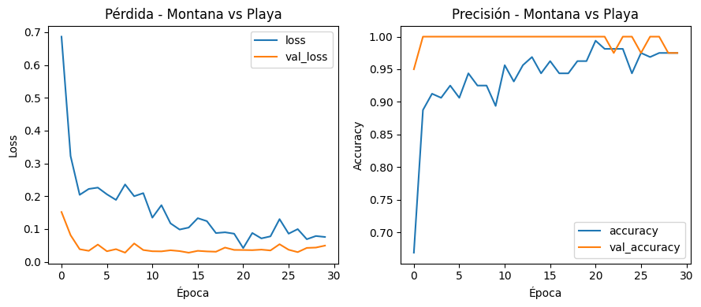
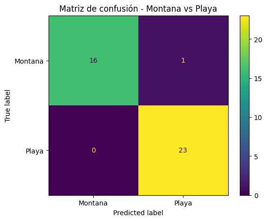

# 🏖️⛰️ Clasificador de fotos «Playa y Montaña» con Transfer Learning

Clasificación binaria de imágenes (**Montaña** vs **Playa**) con una red neuronal convolucional basada en **Transfer Learning con MobileNetV2**, entrenada sobre un dataset muy pequeño (200 imágenes).


---

## 📋 Contexto del problema

La agencia de viajes ficticia **«Playa y Montaña»** quiere clasificar automáticamente las fotos que envían sus clientes durante los viajes. Todas las fotos pertenecen a una de dos categorías: viaje a la **montaña** o viaje a la **playa**.

| Requisito | Detalle |
|---|---|
| Tipo de modelo | Red neuronal convolucional (CNN) |
| Dataset | 100 imágenes por clase (200 en total) |
| Objetivo mínimo | Score ≥ **60 %** |
| Entregable | Justificar la técnica elegida y documentar el proceso |

**Resultado: 97.5 % de accuracy en validación**, muy por encima del 60 % exigido.

---

## 🧠 Técnica elegida: Transfer Learning con MobileNetV2

### ¿Por qué no entrenar una CNN desde cero?

Con solo 200 imágenes, una CNN entrenada desde cero tiene un techo bajo. Lo comprobé experimentalmente (ver [Proceso de mejora](#-proceso-de-mejora)): el modelo se quedaba en torno al **70-75 %** y con un fuerte sesgo hacia la clase *Playa*.

### ¿Por qué Transfer Learning?

**MobileNetV2** está preentrenada sobre **ImageNet** (millones de imágenes), por lo que ya sabe extraer características visuales generales: bordes, texturas, formas, patrones de color. En lugar de aprenderlas desde cero con pocos datos:

1. Se **congela** la base (`trainable = False`) y se reutiliza su conocimiento.
2. Se entrena únicamente un **clasificador nuevo** (la cabeza) para esta tarea concreta.

**Ventajas:**

- ✅ Funciona bien con datasets pequeños.
- ✅ Converge en muy pocas épocas.
- ✅ Menor riesgo de sobreajuste (solo se entrenan unos pocos parámetros).
- ✅ Coste computacional bajo (MobileNetV2 es una arquitectura ligera).

---

## 🏗️ Arquitectura del modelo

```
Entrada (120×120×3)
   │
   ├─ Rescaling (1/255)
   ├─ Data Augmentation: RandomFlip · RandomZoom · RandomBrightness
   │                     RandomContrast · RandomRotation
   │
   ├─ MobileNetV2 (preentrenada en ImageNet, congelada)
   │
   ├─ GlobalAveragePooling2D
   ├─ Dense(128, ReLU, he_uniform)
   ├─ Dropout(0.3)
   └─ Dense(1, sigmoid)  →  probabilidad de «Playa»
```

| Componente | Función |
|---|---|
| **Data augmentation** | Genera variaciones de las imágenes en cada época para mejorar la generalización con pocos datos. Solo se activa durante el entrenamiento. |
| **MobileNetV2 congelada** | Extractor de características preentrenado (~2.26 M de parámetros no entrenables). |
| **GlobalAveragePooling2D** | Reduce los mapas de características a un vector, evitando un `Flatten` enorme. |
| **Dense + Dropout** | Clasificador ligero; el `Dropout(0.3)` reduce el riesgo de overfitting. |
| **Sigmoid** | Salida binaria: `≥ 0.5` → Playa, `< 0.5` → Montaña. |

---

## ⚙️ Pipeline paso a paso

### 1. Carga de datos

```python
datos_train, datos_val = image_dataset_from_directory(
    './fotos',
    class_names=['Montana', 'Playa'],
    label_mode='int',
    image_size=(120, 120),
    batch_size=32,
    validation_split=0.2,
    subset='both',
    seed=24,
)
```

- **160 imágenes** para entrenamiento y **40** para validación (split 80/20).
- Se fija `seed=24` para que la partición sea reproducible.
- Las imágenes se redimensionan a 120×120 px.

### 2. Construcción del modelo

Se carga MobileNetV2 con `include_top=False` (sin su clasificador original de 1000 clases) y `weights='imagenet'`, se congela, y se le añaden encima las capas de aumento de datos y la nueva cabeza clasificadora.

### 3. Entrenamiento

```python
model.compile(optimizer='adam', loss='binary_crossentropy', metrics=['accuracy'])
model.fit(datos_train, epochs=30, validation_data=datos_val)
```

### 4. Evaluación

Curvas de *loss* y *accuracy* para detectar overfitting, y matriz de confusión sobre el conjunto de validación.

---

## 📈 Resultados

### Curvas de entrenamiento



El modelo converge en muy pocas épocas: la `val_accuracy` llega al **100 %** desde la época 2-3 y la `val_loss` se mantiene baja y estable. No se observa overfitting: la pérdida de validación no sube mientras la de entrenamiento baja.

### Matriz de confusión (validación)



| Métrica | Valor |
|---|---|
| **Accuracy (entrenamiento)** | 98.1 % |
| **Accuracy (validación)** | **97.5 %** (39/40 aciertos) |
| **Loss (validación)** | 0.0495 |
| **Recall Montaña** | 94 % |
| **Recall Playa** | 100 % |

---

## 🔄 Proceso de mejora

El proyecto siguió un enfoque iterativo, comparando tres modelos:

| # | Modelo | Accuracy | Observaciones |
|---|---|---|---|
| 1 | CNN desde cero (AvgPool + SGD) | ~70 % | Fuerte sesgo hacia *Playa* (41 % recall en Montaña) |
| 2 | CNN ajustada (MaxPool + Adam) | ~75 % | Sesgo reducido (59 % recall en Montaña) |
| 3 | **Transfer Learning (MobileNetV2)** | **97.5 %** | Recall equilibrado en ambas clases |

**Conclusión:** con datasets pequeños, aprovechar el conocimiento de un modelo preentrenado es más efectivo que ajustar hiperparámetros de una CNN entrenada desde cero.

---

## ⚠️ Limitaciones y posibles mejoras

Con un enfoque crítico, estos son los puntos a tener en cuenta:

- **Conjunto de validación pequeño (40 imágenes):** cada imagen pesa un 2.5 % del accuracy, por lo que la métrica tiene bastante varianza. Una validación cruzada (*k-fold*) daría una estimación más fiable.
- **Sin conjunto de test independiente:** la validación se usa para monitorizar el entrenamiento; lo ideal sería reservar un *test set* aparte.
- **Preprocesado de MobileNetV2:** la red espera entradas en el rango `[-1, 1]` (`mobilenet_v2.preprocess_input`), mientras que aquí se usa `Rescaling(1/255)`, que produce `[0, 1]`. Funciona bien, pero usar el preprocesado oficial podría mejorar aún más el resultado.
- **Tamaño de entrada:** MobileNetV2 se entrenó con 224×224 (Keras avisa de ello con 120×120). Probar con 128×128 o 224×224 podría aportar precisión.
- **Fine-tuning:** descongelar las últimas capas de la base con una tasa de aprendizaje muy baja es el siguiente paso natural.
- **Early stopping:** el notebook importa `EarlyStopping` pero no lo usa; añadirlo evitaría épocas innecesarias.

---

## 🚀 Cómo ejecutarlo

```bash
# 1. Clonar el repositorio
git clone https://github.com/Yucsan/Clasificador_RNC.git
cd .\Clasificador_RNC\

# 2. Instalar dependencias
pip install tensorflow matplotlib numpy scikit-learn jupyter

# 3. Colocar las imágenes con esta estructura
#    fotos/
#    ├── Montana/
#    └── Playa/

# 4. Abrir el notebook
jupyter notebook agenciaviajes.ipynb
```

---

## 🛠️ Tecnologías

- **Python**
- **TensorFlow / Keras** — modelo, data augmentation y carga de datos
- **MobileNetV2** — base preentrenada (ImageNet)
- **scikit-learn** — matriz de confusión
- **Matplotlib / NumPy** — visualización y manejo de arrays

---

## 👤 Autor

**Fernando Yucsan Chang Cam**

[](https://github.com/<tu-usuario>)
